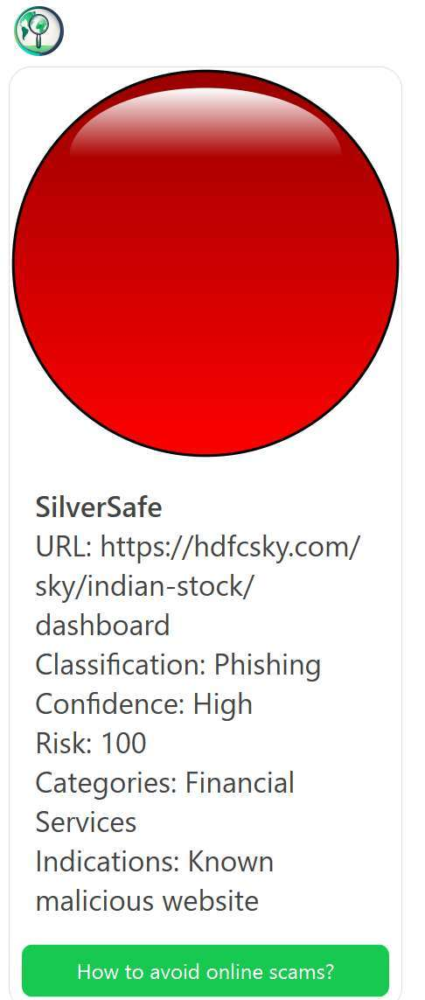

# Real-Time Phishing Detection Bot

A LINE bot prototype that checks submitted URLs with a threat-reputation
service and returns a readable traffic-light risk report.

## Demo



This is a real result from the working prototype. It shows the bot identifying
a phishing URL with a high-confidence red warning. No credentials, account
details, QR codes, or private conversation history are included.

## What I built

- URL reputation lookup through a configurable threat-intelligence API
- Automatic extraction of a web link from a normal text message
- Red, yellow, and green classification logic
- LINE Flex Message output with classification, confidence, risk, categories,
  and threat indications
- English and Chinese development versions
- Flask webhook signature validation
- Environment-variable configuration for all credentials and API endpoints

## Development journey

I started this project in 2024 while learning Python and the LINE Messaging API.
The earliest version was a basic echo and rich-message bot. I then connected the
bot to a URL-reputation API and tested the prototype with roughly 200 people in
my extended network.

That feedback exposed a usability problem: requiring `/url` before every
address was easy to forget. I updated the English version to find a web link
inside a normal message automatically, so users can paste or forward suspicious
text without learning a special command.

The repository keeps the earlier LINE feature experiments because they show how
the project developed. The phishing-specific implementation is in
`English_Version.py` and `Chinese_Version.py`; `app.py`, `Function.py`, and
`new.py` are earlier learning prototypes rather than the final phishing flow.

## Current flow

1. A user sends or forwards any text message containing a web link, such as
   `Congrats! You won a $500 shopping prize. Claim it at https://prize.example/claim-now!`
2. LINE sends the signed webhook request to the Flask application.
3. The English version extracts the first web link from the message.
4. The application requests reputation data from the configured service.
5. The response is converted into a red, yellow, or green result.
6. The bot returns a LINE Flex Message with the available details.

## Project structure

```text
.
|-- English_Version.py     # English entry point with automatic URL extraction
|-- Chinese_Version.py     # Parallel language prototype
|-- app.py                 # Earlier LINE webhook experiments
|-- Function.py            # Earlier rich-message experiments
|-- new.py                 # Earlier image-carousel experiment
|-- assets/
|   `-- phishing-detection-demo.jpg
|-- tests/
|   `-- test_reputation.py
|-- Procfile
|-- requirements.txt
`-- .env.example
```

## Local setup

1. Create and activate a Python virtual environment.
2. Install dependencies:

   ```bash
   pip install -r requirements.txt
   ```

3. Set the variables shown in `.env.example` using credentials from your own
   service accounts.
4. Start one of the phishing prototypes:

   ```bash
   python English_Version.py
   ```

5. Configure the LINE webhook URL to point to `/callback` on your HTTPS host.

## Tests

The tests use local fakes rather than real credentials or network calls. They
cover URL extraction from normal messages; dangerous, uncertain, and benign
classifications; API token handling; and parsing of complete and partial
reputation responses.

```bash
python -m unittest discover -s tests -v
```

## Security

- Real credentials are never included in the repository.
- `.env`, logs, virtual environments, and temporary images are ignored.
- Test data uses reserved example domains and mocked API responses.
- The result is reputation information, not a guarantee that a URL is safe.

If any credential was committed during early development, it must be revoked
and replaced before the bot is deployed again.

## Built with

Python · Flask · LINE Bot SDK · Threat Intelligence API

